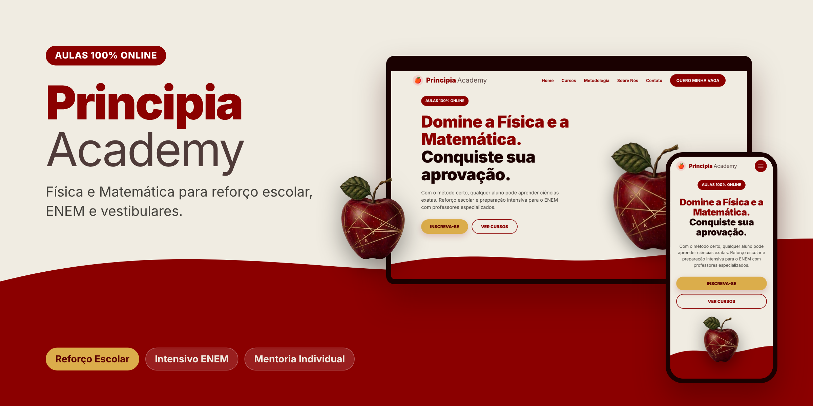

  

<h1 align="center">Principia Academy</h1>

  <strong>Física e Matemática online para reforço escolar, ENEM e vestibulares</strong>

  <a href="https://www.principiacademy.com.br">www.principiacademy.com.br</a>

## Sobre o projeto

A Principia Academy é um cursinho online de Física e Matemática. A proposta é mostrar que qualquer aluno pode aprender ciências exatas quando encontra o método certo, com professores que gostam de ensinar e turmas pequenas, de até 10 alunos.

O nome é uma homenagem ao *Principia Mathematica*, de Isaac Newton. A maçã da marca lembra a história da gravidade e os traços dourados sobre ela representam a geometria e os cálculos que explicam o mundo.

Este repositório guarda o site do cursinho, que apresenta os cursos, a forma de trabalho e a equipe, e reúne os canais para quem quer se inscrever. O site funciona no computador, no tablet e no celular.

## Cursos

O **Reforço Escolar** acompanha alunos do Ensino Fundamental e do Ensino Médio que precisam fortalecer a base em Física e Matemática, com material próprio e plantão de dúvidas.

O **Intensivo Pré-Vestibular** prepara para o ENEM e para os principais vestibulares, com resolução de provas anteriores, simulados e estudo voltado para a Teoria de Resposta ao Item.

A **Mentoria Individual** é para quem quer aprender a estudar, com cronograma feito sob medida e acompanhamento semanal do desempenho.

## Como ensinamos

O caminho do aluno começa com um diagnóstico do que ele já sabe. Depois vem a construção dos fundamentos, entendendo o porquê antes do como. Em seguida entra a prática orientada com exercícios progressivos e, por fim, os simulados com revisão e estratégia de prova.

As aulas acontecem ao vivo e ficam gravadas para revisão, e cada aluno acompanha a própria evolução ao longo do curso.

## Contato

Para conhecer as turmas e fazer a inscrição, acesse o site e preencha o formulário. A mensagem chega direto no WhatsApp do cursinho. Também estamos no Instagram e no YouTube como **@principiacademy**.

  Feito no Pará 🍎

